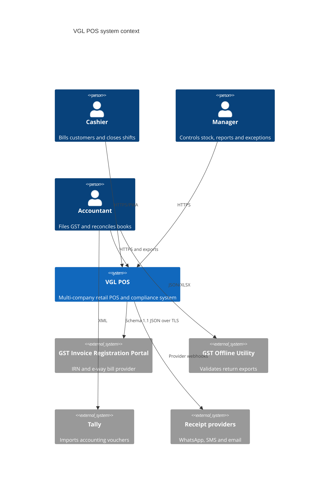
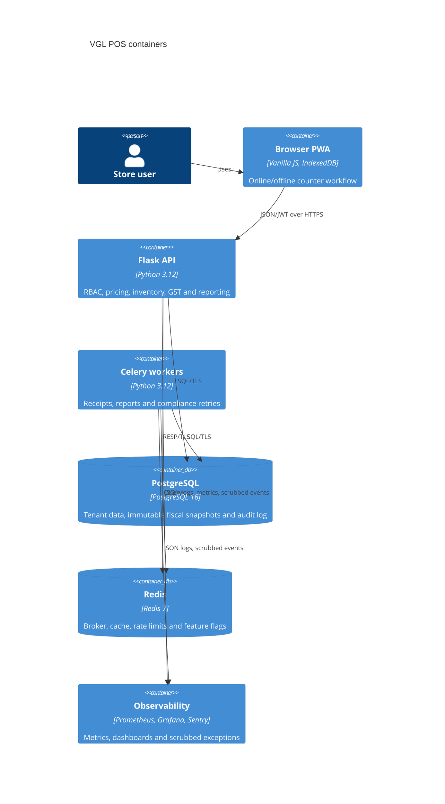

# VGL POS architecture

## System context (C4 level 1)

## Containers (C4 level 2)

## Key boundaries

The browser is untrusted. Prices, tax, permissions, tenant/branch scope, stock, document numbers and totals are recomputed server-side. Mutations use idempotency keys; offline sales add a signed terminal-bound payload and UUID. Services own transactions and publish only after commit.

PostgreSQL is the system of record. Sales preserve tax/cost/supplier/batch snapshots. Stock and audit ledgers are append-only; the runtime role has no audit update/delete privilege. Celery work begins from durable database rows, so worker termination cannot lose a report or compliance request.

The application emits no migration during boot. A release migration job completes before readiness-gated rolling pods change image. Nightly encrypted dumps and continuous encrypted WAL archives target a private object store; the age identity resides in the secret manager, never beside backups.

Every request receives a request ID. Authentication adds user, company and branch context. Structured logs, bounded-label Prometheus metrics, privacy-scrubbed Sentry events, two Grafana dashboards and linked alert runbooks form the operations surface.
