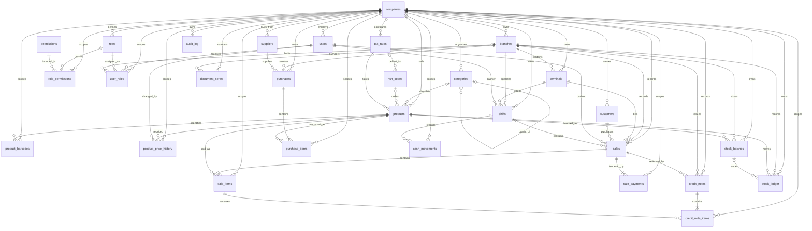

# VGL POS Phase 1B entity relationship diagram

This diagram reflects the complete model registry. Audit actor relationships
(`created_by`, `updated_by`, `deleted_by` → `users.id`) are omitted from the
diagram to keep the business relationships readable.

