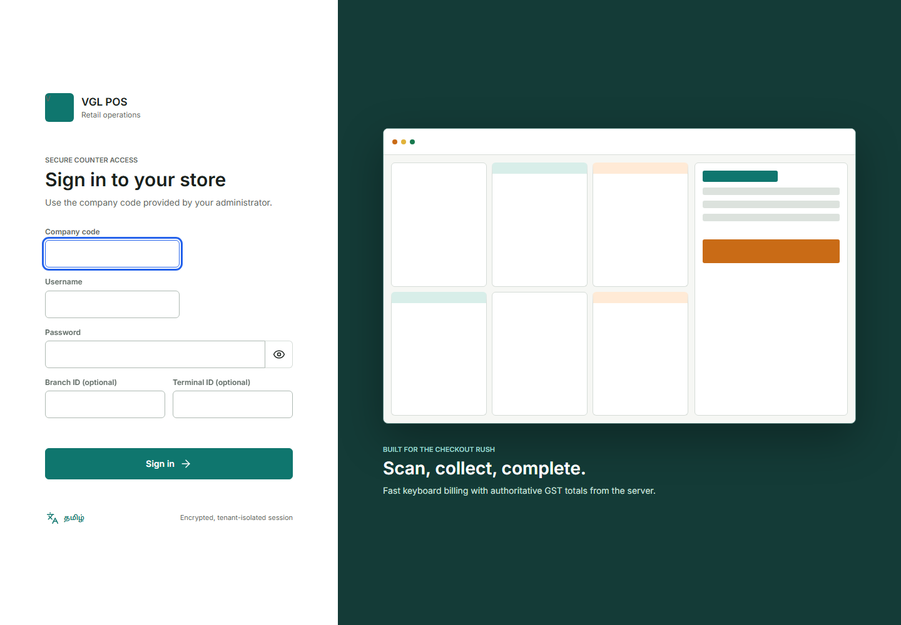
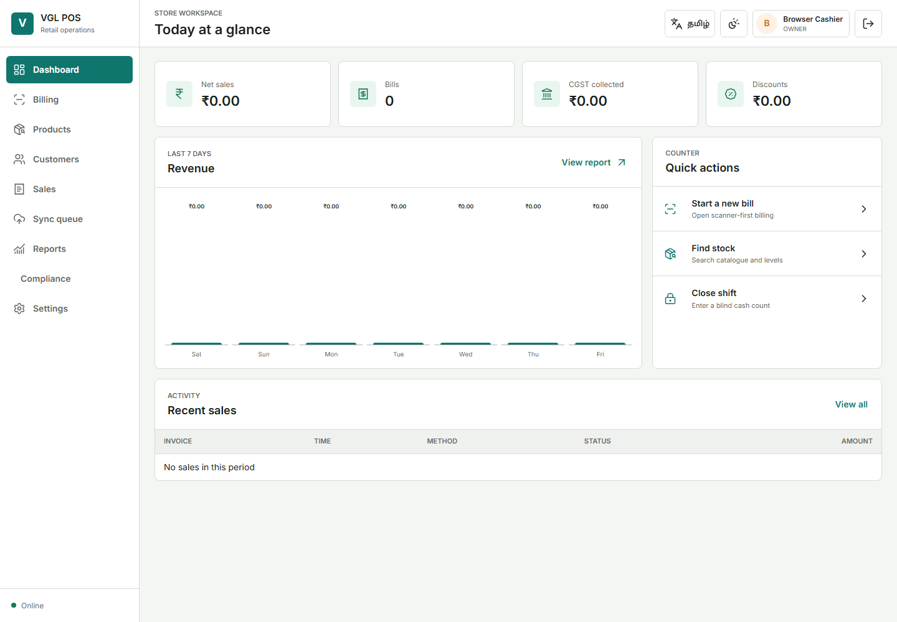
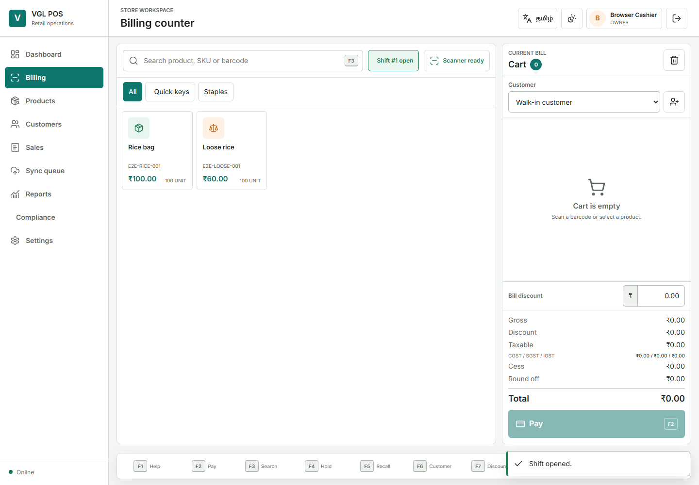
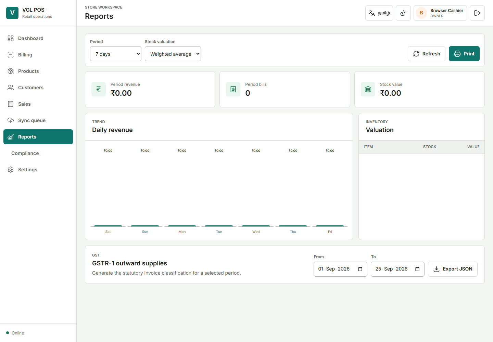
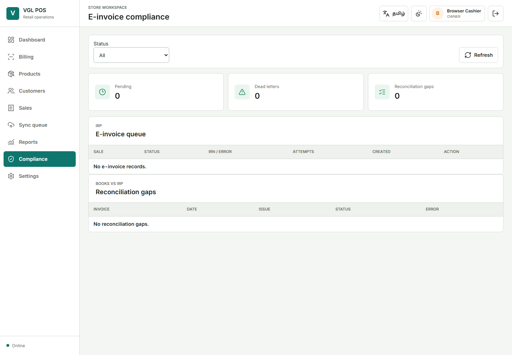

# VGL POS பயனர் வழிகாட்டி (தமிழ்)

எல்லா படங்களிலும் பயிற்சிக்கான மாதிரி தரவு மட்டுமே உள்ளது. பயனர் அனுமதியைப் பொறுத்து உங்கள் திரையில் சில செயல்கள் தெரியாமல் இருக்கலாம்.

## உள்நுழைவு மற்றும் ஷிப்ட் தொடக்கம்

நிர்வாகி வழங்கிய நிறுவனக் குறியீடு, பயனர் பெயர், கடவுச்சொல் ஆகியவற்றை உள்ளிடவும். கேட்கப்பட்டால் ஒதுக்கப்பட்ட கிளை மற்றும் டெர்மினலைத் தேர்ந்தெடுக்கவும். கடவுச்சொல் அல்லது MFA குறியீட்டை பகிர வேண்டாம். பில்லிங் தொடங்கும் முன் ஷிப்டைத் திறந்து, தொடக்க ரொக்கத்தை நோட்டு மதிப்புகளின்படி பதிவு செய்யவும்.

## டாஷ்போர்டு மற்றும் பில்லிங்

டாஷ்போர்டு அனுமதிக்கப்பட்ட கிளைக்கான விற்பனை மற்றும் செயல்பாட்டு சுருக்கத்தைக் காட்டும். பழைய ஆவணங்களை மாற்றாமல் எச்சரிக்கைகளைச் சரிபார்க்கவும்.

பார்கோடை ஸ்கேன் செய்யவும் அல்லது பொருளைத் தேடவும்; அளவை உறுதிப்படுத்தி தேவையானால் வாடிக்கையாளரைத் தேர்ந்தெடுக்கவும். Quote மூலம் சர்வர் கணக்கிட்ட தொகையைச் சரிபார்க்கவும். Cash/Card/UPI/Loyalty கட்டணங்களைச் சேர்க்கலாம்; மீதித் தொகை ரொக்கத்திலிருந்து மட்டுமே வழங்கப்படும். Complete-ஐ ஒருமுறை அழுத்தி ரசீதுக்காக காத்திருக்கவும். இணையம் துண்டிக்கப்பட்டால் offline முறையில் தொடரவும்; sync வெற்றியடையும் வரை queue-ஐ அழிக்கவோ பில்லை மீண்டும் உள்ளிடவோ வேண்டாம்.

வாடிக்கையாளர் காத்திருக்கும்போது bill-ஐ Hold செய்யலாம். Recall செய்தபின் இருப்பும் விலையும் மறுபரிசோதிக்கப்படும். Return அசல் விற்பனையைச் சுட்டிக்காட்ட வேண்டும். Cancellation, அதிக discount, receipt reprint, shift variance ஆகியவற்றுக்கு மேலாளர் ஒப்புதலும் காரணமும் தேவை.

## அறிக்கைகள் மற்றும் GST இணக்கம்

அறிக்கை, காலவரம்பு, கோப்பு வடிவம் ஆகியவற்றைத் தேர்ந்தெடுக்கவும். பெரிய export-கள் பின்னணி job ஆகும்; Completed ஆன பின் download செய்யவும். தோல்வி job-களின் காரணம் பாதுகாப்பாகச் சேமிக்கப்படும்.

Pending/dead-letter e-invoice, reconciliation மற்றும் e-way bill நிலைகளை கணக்காளர் தினமும் பார்க்க வேண்டும். பிழையைத் திருத்திய பின் மட்டுமே retry செய்யவும். IRN cancellation காலவரம்புடையதும் audit செய்யப்படுவதுமாகும். தாக்கலுக்கு முன் GSTR-1 JSON/XLSX-ஐ அரசு Offline Utility-யிலும், Tally XML-ஐ trial company-யிலும் சரிபார்க்கவும்.

## ஷிப்ட் முடித்தல்

Expected cash-ஐ பார்க்காமல் ரொக்கத்தை எண்ணி நோட்டு மதிப்புகளுடன் பதிவு செய்யவும். Hold bill-களை முடித்து Close செய்யவும். நிர்ணய வரம்பை மீறும் வேறுபாட்டுக்கு மேலாளர் ஒப்புதலும் காரணமும் தேவை. கடை விதிமுறையின்படி Z-report-ஐ பாதுகாக்கவும்.
